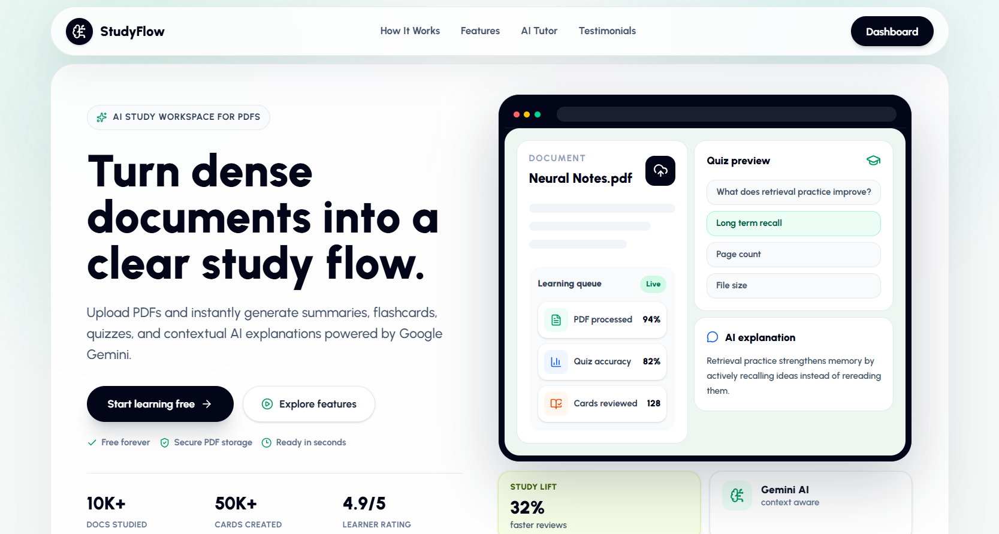

<p align="center">
  
</p>

<h1 align="center">📚 StudyFlow — AI-Powered Document & Workspace Learning Platform</h1>

### 🌐 Live Demo — [https://studyflow-ai-alpha.vercel.app/](https://studyflow-ai-alpha.vercel.app/)

<p align="center">
  <strong>Single & Multi-Document Workspaces • Vector Search RAG • SSE Streaming Chat • Mindmaps • Flashcards & Quizzes</strong><br/>
  A full-stack TypeScript & MERN application powered by Google Gemini AI that transforms static PDFs into interactive, intelligent learning workspaces.
</p>

<p align="center">
  
  
  
  
  
  
  
  
  
  
  
</p>



---

## 🌟 Key Highlights & Architecture

- **📂 Multi-Document Workspaces:** Group multiple PDFs into custom-color workspaces for cross-document synthesis across lectures, textbooks, and research papers.
- **⚡ Server-Sent Events (SSE) Streaming:** Real-time token streaming for AI chat using `@google/genai` (`gemini-2.5-flash-lite`) with instant responsive rendering.
- **🔍 Dual-Mode Vector Search RAG:** Embeddings generated via `gemini-embedding-001` (768 dimensions) stored in `DocumentChunk`. Searches via MongoDB Atlas `$vectorSearch` with automatic fallback to in-memory cosine similarity.
- **🏷️ Source-Attributed Citations:** Chat responses include exact document name, page number, and chunk references for verifiable, hallucination-free answers.
- **🧠 Interactive React Flow Mindmaps:** Hierarchical visual knowledge graphs generated for single PDFs or entire multi-doc workspaces with pan, zoom, and auto-layout.
- **🃏 Auto-Generated Study Decks & Quizzes:** Q&A flashcards with spaced review tracking and 4-option MCQs with instant scoring and explanations.
- **🛡️ Cascading Cleanup & Security:** Document and workspace deletions cleanly purge Cloudinary files, vector chunks, decks, quizzes, and chat histories in parallel.

---

## ✨ Full Feature Overview

### 📄 Document & Workspace Management
- **Direct-to-Cloudinary Upload** — Signed frontend uploads for PDFs up to 10MB bypass serverless payload limits with live progress bars.
- **Smart Chunking & Vector Indexing** — Client-side text extraction (`pdfjs-dist`) with server fallback, chunked and embedded (768-dim) into MongoDB.
- **6-Tab Workspace Hub** — Dedicated tabs for Documents, Cross-Doc AI Chat, Executive Summary, Concept Mindmap, Flashcards, and Quizzes.

### 🤖 AI Suite (Google Gemini 2.5)
- **Streaming Document & Workspace Chat** — SSE chat streaming with conversation history persistence and exact source citations.
- **Executive Summaries** — Structured summaries generated from single PDFs or synthesized across multiple workspace documents.
- **Visual Mindmaps** — Auto-generated concept trees rendered via React Flow (`@xyflow/react`) with persistent storage.
- **Flashcards & Quizzes** — Adaptive study sets (`/api/flashcards/set/:setId`) and quizzes with answer validation and progress tracking.

### 📊 Progress & 🔐 Authentication
- **Analytics Dashboard** — Activity feeds, quiz scores, total materials, and deterministic study streak tracking.
- **Hybrid Auth** — JWT authentication (7-day expiry) with bcrypt password hashing and Google OAuth 2.0 verification.
- **Full Test Suite** — 26 unit and integration test suites powered by Vitest across backend (12) and frontend (14).

---

## 🏗️ Tech Stack

- **Frontend:** React 19, Vite 7, TypeScript, TailwindCSS 4, React Router v7, React Flow (`@xyflow/react`), `pdfjs-dist`, Axios, Lucide React, Lenis, Vitest.
- **Backend:** Node.js 18+, Express 5, TypeScript (`server.ts`, `tsx`), Mongoose 9, MongoDB Atlas, Cloudinary SDK, Express Rate Limit, Vitest.
- **AI & Vector Engine:** `@google/genai` (v1.43.0), `gemini-2.5-flash-lite`, `gemini-embedding-001` (768-dim), Atlas `$vectorSearch` + Cosine Fallback.

---

## 🚀 Getting Started

### Prerequisites
- Node.js 18+ and MongoDB Atlas cluster (with optional vector search index)
- Cloudinary account & Google Cloud project (OAuth Client ID & Gemini API key)

### Setup Instructions

1. **Clone Repository**
   ```bash
   git clone https://github.com/iamalok123/studyflow-mern-fullstack.git
   cd studyflow-mern-fullstack
   ```

2. **Backend Setup**
   ```bash
   cd backend
   npm install
   npm run dev    # Starts tsx watch server.ts on http://localhost:5000
   npm test       # Runs 12 Vitest backend test suites
   ```
   *Create a `.env` file in `backend/` with:*
   ```env
   PORT=5000
   MONGO_URI=your_mongodb_atlas_uri
   JWT_SECRET=your_jwt_secret_min_32_chars
   GEMINI_API_KEY=your_gemini_api_key
   CLOUDINARY_CLOUD_NAME=your_cloudinary_name
   CLOUDINARY_API_KEY=your_cloudinary_api_key
   CLOUDINARY_API_SECRET=your_cloudinary_api_secret
   GOOGLE_CLIENT_ID=your_google_client_id
   FRONTEND_URL=http://localhost:5173
   ```

3. **Frontend Setup**
   ```bash
   cd ../frontend
   npm install
   npm run dev    # Starts Vite on http://localhost:5173
   npm test       # Runs 14 Vitest frontend test suites
   ```
   *Create a `.env` file in `frontend/` with:*
   ```env
   VITE_API_URL=http://localhost:5000/api
   VITE_GOOGLE_CLIENT_ID=your_google_client_id
   ```

---

## 🔌 Core API Endpoints

- **Auth:** `/api/auth/register`, `/api/auth/login`, `/api/auth/google`, `/api/auth/profile`, `/api/auth/change-password`
- **Documents:** `/api/documents/upload-signature`, `/api/documents/upload`, `/api/documents`, `/api/documents/:id`
- **Workspaces:** `/api/workspaces`, `/api/workspaces/:id`, `/api/workspaces/:id/documents`, `/api/workspaces/:id/documents/:documentId`
- **AI Suite (SSE & REST):** `/api/ai/stream-chat` (SSE), `/api/ai/workspace-stream-chat` (SSE), `/api/ai/generate-summary`, `/api/ai/workspace-summary`, `/api/ai/generate-mindmap`, `/api/ai/workspace-mindmap`, `/api/ai/generate-flashcards`, `/api/ai/workspace-flashcards`, `/api/ai/generate-quiz`, `/api/ai/workspace-quiz`
- **Study & Progress:** `/api/flashcards/set/:setId`, `/api/flashcards/workspace/:workspaceId`, `/api/quizzes/:id/submit`, `/api/quizzes/workspace/:workspaceId`, `/api/progress/dashboard`

---

## 🗄️ Database Collections (MongoDB Atlas)

- **User:** Authentication credentials, profile avatars, Google OAuth identities.
- **Document:** PDF metadata, Cloudinary CDN links, extracted text, embedded mindmaps.
- **DocumentChunk:** Vector chunks with 768-dim embeddings, page numbers, and document/workspace references.
- **Workspace:** Multi-document folder metadata, document ID array, embedded workspace summary & mindmap.
- **Flashcard:** AI-generated study sets with individual card review counts and star favorites.
- **Quiz:** Multiple-choice practice exams with options, correct answers, explanations, and user scores.
- **ChatHistory:** Multi-turn conversation logs with source citations and referenced chunk indices.

---

## 🌍 Production Deployment

- **Frontend:** Configured with `frontend/vercel.json` for single-page application routing on Vercel.
- **Backend:** TypeScript builds via `tsc` to `dist/server.js`, with serverless entry via `backend/api/index.js` and `backend/vercel.json`.

---

## 🤝 License
Licensed under the **ISC License**.
